<p align="center">
  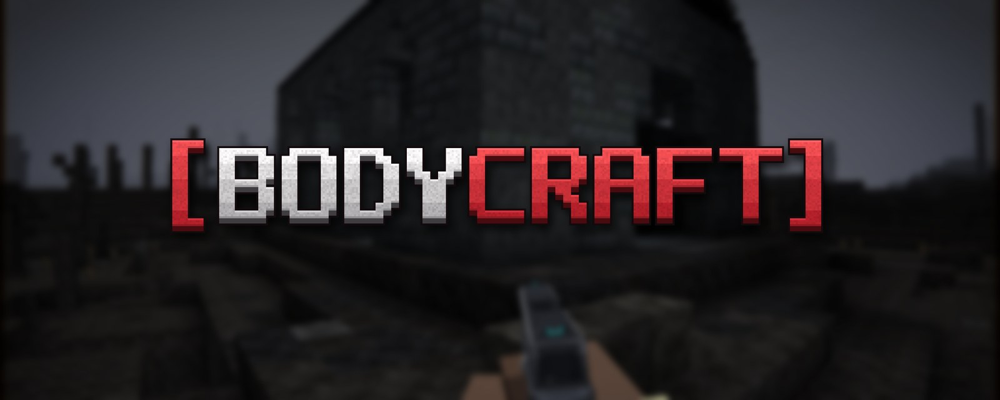
</p>

<p align="center">
  <b>A bodycam shooter built in Minecraft.</b><br>
  Every round is seen through a body camera: lens, grain, shaking hands and reloads that go wrong under fire.
</p>

<p align="center">
  <a href="https://github.com/MrStiv2/BODYCRAFT/releases/download/launcher/BODYCRAFT-Launcher-Windows.exe"></a>
  &nbsp;
  <a href="https://github.com/MrStiv2/BODYCRAFT/releases/download/launcher/BODYCRAFT-Launcher-macOS.zip"></a>
</p>

<p align="center">
  <a href="#support-the-project"></a>
</p>

<p align="center">
  <sub>One click downloads the launcher. It installs BODYCRAFT, keeps it updated and opens Minecraft with the BODYCRAFT profile selected.<br>
  Minecraft 1.21.1 · NeoForge 21.1.267 · <a href="https://github.com/MrStiv2/BODYCRAFT/releases">All releases and changelogs</a></sub>
</p>

<br>

<p align="center">
  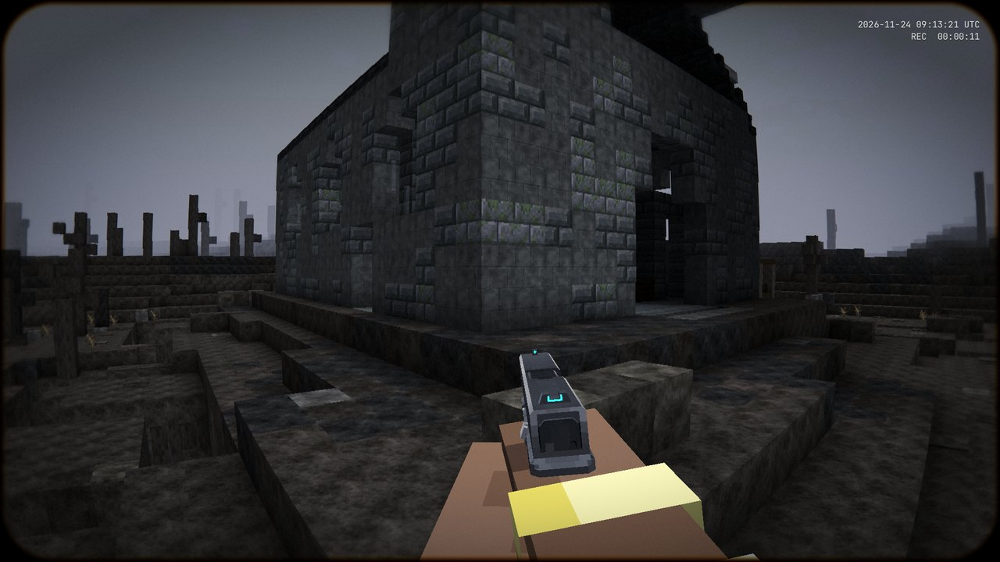
</p>

## What is BODYCRAFT

BODYCRAFT turns Minecraft Java Edition into a close-quarters tactical shooter recorded from a body camera. Rounds take place on **Bell Ridge**, a ruined church on a hill cut through with trenches and crypts. Play solo against bots or with friends over LAN.

- **Team Deathmatch, Free for All and Gun Game.** Bots fill the empty slots and fight like players.
- **16 weapons with real handling:** M4A1, AK-74M, MP5A5, SCAR-H, M870, M700, SVD, Uzi, Vector, Glock 17, CZ 75, Desert Eagle, M1911, Taurus 943, MK23 and TEC-9.
- **A body camera, not a game camera.** Wide-angle lens distortion, sensor grain, motion and a recording timestamp. Lean around corners, go prone and light up dark rooms with the weapon flashlight.
- **A field tablet** for loadouts, attachments, uniforms, team and LAN settings. It comes out of your backpack and stays in your hands while the round goes on.
- **Frag grenades and FPV strike drones,** blood, ragdolls and positional sound.

## Stress reloads

Under fire your hands stop being steady. When a fight gets close, reloads go wrong: the magazine catches the edge of the well and goes in crooked, the hand misses the bolt release or slips off the slide, a shotgun shell slips through the fingers. Every weapon has three hand-made stressed reloads, and they only play when you are under pressure.

<table>
  <tr>
    <td width="50%">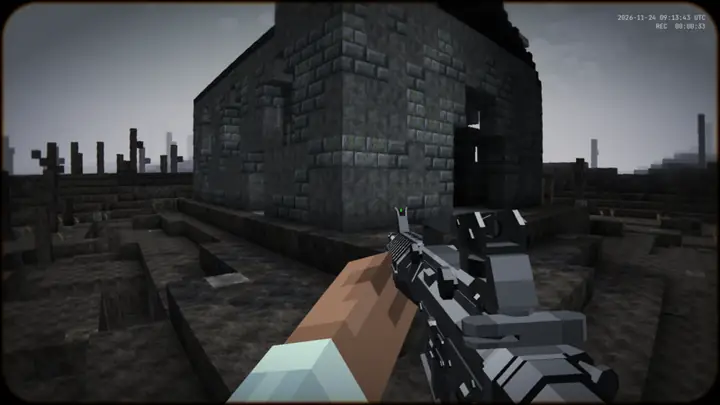</td>
    <td width="50%">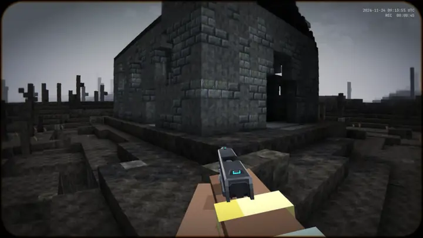</td>
  </tr>
  <tr>
    <td><sub><b>M4A1.</b> The magazine is forced in crooked, then the hand misses the bolt release.</sub></td>
    <td><sub><b>Glock 17.</b> The magazine goes in crooked and the hand slips off the slide.</sub></td>
  </tr>
  <tr>
    <td>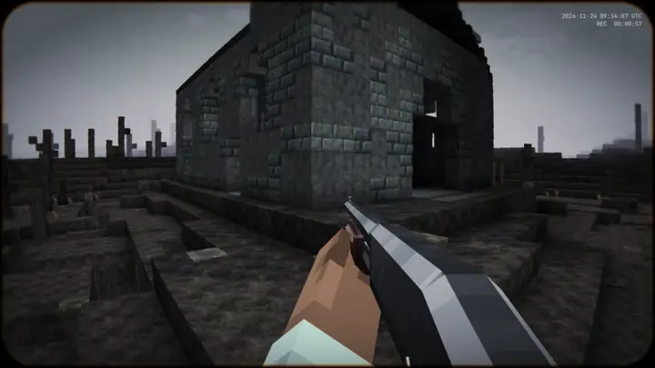</td>
    <td>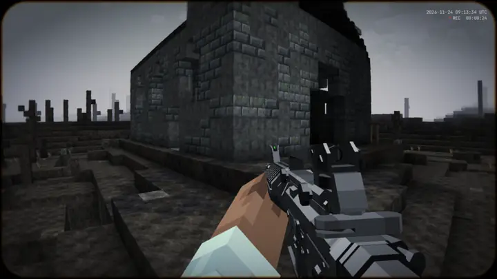</td>
  </tr>
  <tr>
    <td><sub><b>M870.</b> The first shell misses the ejection port and the pump is short-stroked.</sub></td>
    <td><sub><b>Field tablet.</b> The rifle goes down on its sling and the tablet comes out of the backpack.</sub></td>
  </tr>
</table>

## Bell Ridge

<table>
  <tr>
    <td width="50%">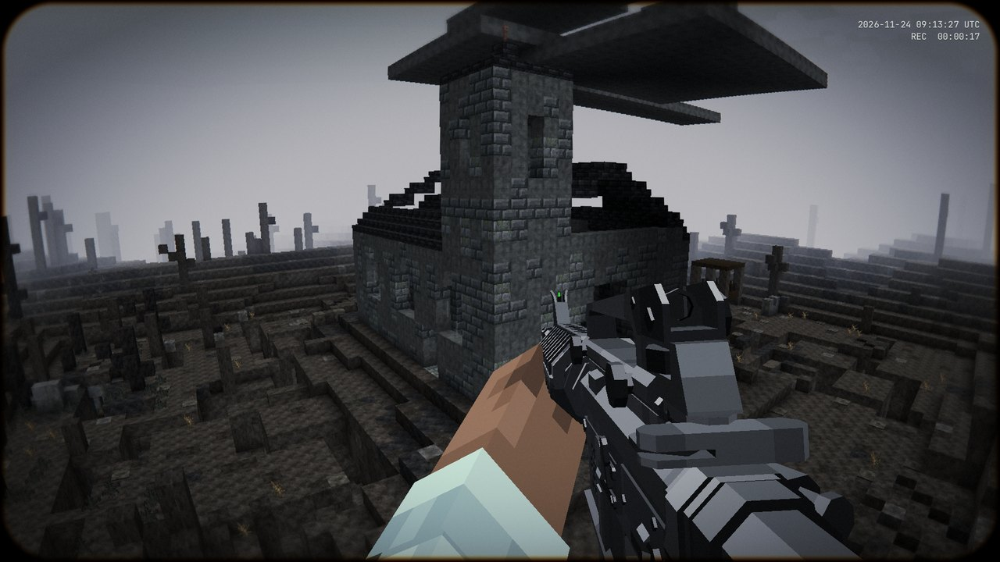</td>
    <td width="50%">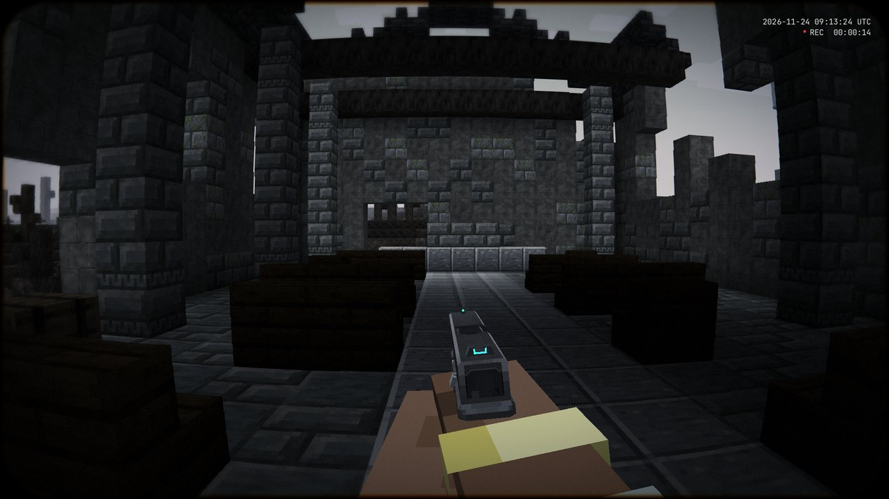</td>
  </tr>
  <tr>
    <td>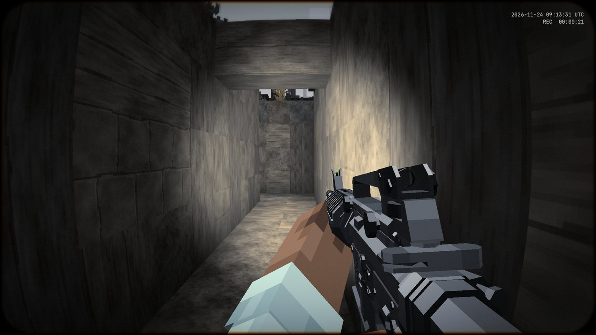</td>
    <td>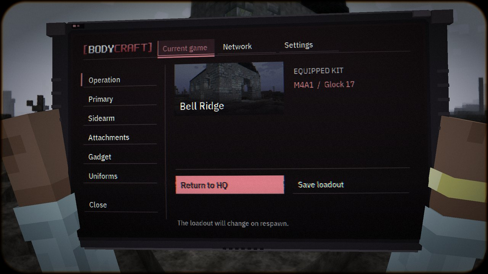</td>
  </tr>
</table>

## The launcher

<table>
  <tr>
    <td width="50%">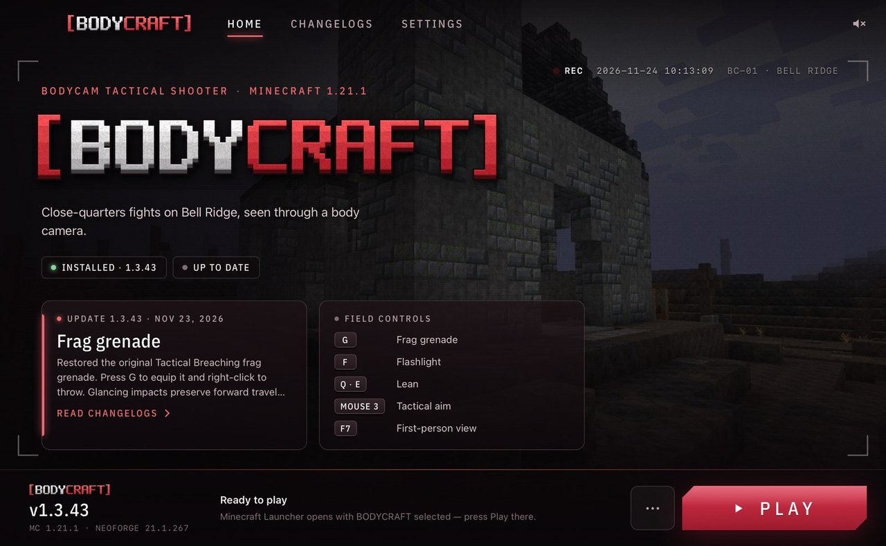</td>
    <td width="50%">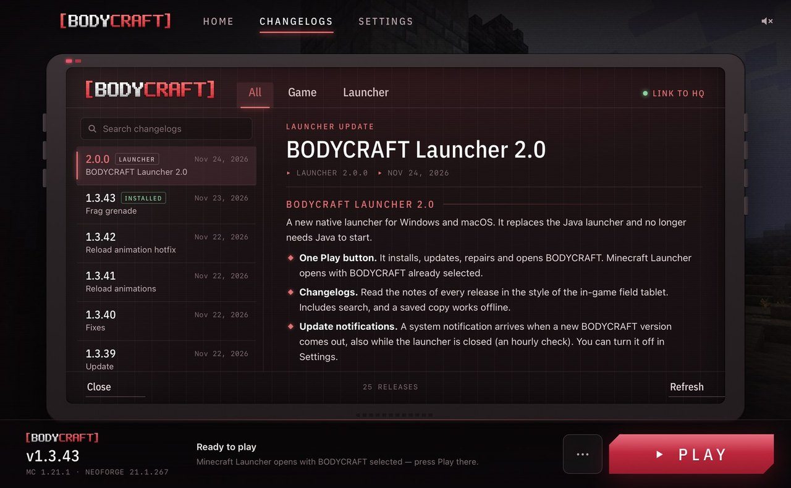</td>
  </tr>
  <tr>
    <td><sub>One <b>Play</b> button installs, updates, repairs and starts BODYCRAFT.</sub></td>
    <td><sub><b>Changelogs</b> of every release, styled like the in-game field tablet.</sub></td>
  </tr>
</table>

## Install

1. Download the launcher for your system with the buttons above.
   - **Windows 10 or 11:** run `BODYCRAFT-Launcher-Windows.exe`. It installs itself for your user and adds Start menu and desktop shortcuts. If SmartScreen appears, choose **More info › Run anyway**.
   - **macOS 13 or later:** unzip `BODYCRAFT-Launcher-macOS.zip` and move **BODYCRAFT Launcher** to Applications. If macOS blocks the first start, open **System Settings › Privacy & Security** and choose **Open Anyway**.
2. Press **Play**. The launcher installs BODYCRAFT as its own profile in the official Minecraft Launcher, then opens Minecraft Launcher with BODYCRAFT selected.
3. Press **Play** in Minecraft Launcher.

You need Minecraft Java Edition with the official Minecraft Launcher and an internet connection for the first install. The launcher downloads BODYCRAFT from this repository's releases, NeoForge from its official Maven repository and the other mods at their pinned versions from [Modrinth](https://modrinth.com/) and [CurseForge](https://www.curseforge.com/minecraft).

## Updates

The launcher checks for new versions while it is open and once an hour while it is closed, and sends a system notification when a new BODYCRAFT version comes out. Updates keep your worlds, extra mods, controls and memory setting. The launcher updates itself as well.

Older launchers (1.3.22 or newer) offer Launcher 2 by themselves after their next restart. Release notes for every version are on the [Releases](https://github.com/MrStiv2/BODYCRAFT/releases) page and in the launcher's **Changelogs**.

## Support the project

BODYCRAFT is free, and it stays free. If you enjoy it and want to help its development, you can send a tip in USDT. It is entirely optional.

<table>
  <tr>
    <td align="center" width="50%"><br><b>USDT · TRC20 (Tron)</b></td>
    <td align="center" width="50%"><br><b>USDT · BEP20 (BNB Smart Chain)</b></td>
  </tr>
</table>

**USDT · TRC20 (Tron)**

```
TPSXMXp1rAQkkVcXEHbx2pxsFKmYYA3coN
```

**USDT · BEP20 (BNB Smart Chain)**

```
0xffa8b5b1b6dd98e12ae07ae7f1242210d8acd58f
```

> [!WARNING]
> Send only USDT, and only in the network named above its address. Funds sent in another network, such as Ethereum (ERC20), can be lost.

<details>
<summary><b>Manual install without the launcher</b></summary>

<br>

Each game release has a ZIP for Minecraft 1.21.1, NeoForge 21.1.267 and Java 21, for example [BODYCRAFT 1.3.43](https://github.com/MrStiv2/BODYCRAFT/releases/download/v1.3.43/BodyCraft-1.3.43-NeoForge-1.21.1.zip). Its `BodyCraft/` folder is a complete game directory with the map, controls and `mods-lock.json`, which lists every mod with its version, checksum and download page. Mods marked as downloads are not bundled: get each one from the page listed in `mods-lock.json`.

The launcher's update manifest is [bodycraft-update.json](https://github.com/MrStiv2/BODYCRAFT/releases/latest/download/bodycraft-update.json).

</details>

<details>
<summary><b>Built with</b></summary>

<br>

BODYCRAFT runs on NeoForge and builds on these mods, downloaded from their authors' pages at pinned versions:
[TaCZ](https://www.curseforge.com/minecraft/mc-mods/timeless-and-classics-zero),
[Body Cam](https://www.curseforge.com/minecraft/mc-mods/body-cam),
[Tactical Breaching](https://www.curseforge.com/minecraft/mc-mods/tacz-tactical-breaching),
[TaCZ: Immersive Ballistic](https://www.curseforge.com/minecraft/mc-mods/tacz-immersive-ballistic),
[TaCZ: Lights](https://www.curseforge.com/minecraft/mc-mods/tacz-lights),
[TaCZ Tweaks](https://www.curseforge.com/minecraft/mc-mods/tacz-tweaks),
[TaCZ Lean & Crawl](https://modrinth.com/mod/tacz-lean-crawl),
[Superb Warfare](https://www.curseforge.com/minecraft/mc-mods/superb-warfare),
[Ragdollified](https://www.curseforge.com/minecraft/mc-mods/ragdollified),
[Ragdollified Amputation](https://www.curseforge.com/minecraft/mc-mods/ragdollified-amputation),
[Cruor](https://www.curseforge.com/minecraft/mc-mods/cruor),
[Sound Physics Remastered](https://modrinth.com/mod/sound-physics-remastered),
[Presence Footsteps](https://modrinth.com/mod/pf-neoforge),
[First-person Model](https://modrinth.com/mod/first-person-model),
[Not Enough Animations](https://modrinth.com/mod/not-enough-animations),
[CameraOverhaul](https://modrinth.com/mod/cameraoverhaul),
[Immersive Weathering: Renewed](https://www.curseforge.com/minecraft/mc-mods/immersive-weathering-renewed-by-qanoriaports)
and their libraries. Thanks to all of their authors.

</details>

<p align="center"><sub>BODYCRAFT is a fan project. It is not an official Minecraft product and is not approved by or associated with Mojang or Microsoft.</sub></p>
